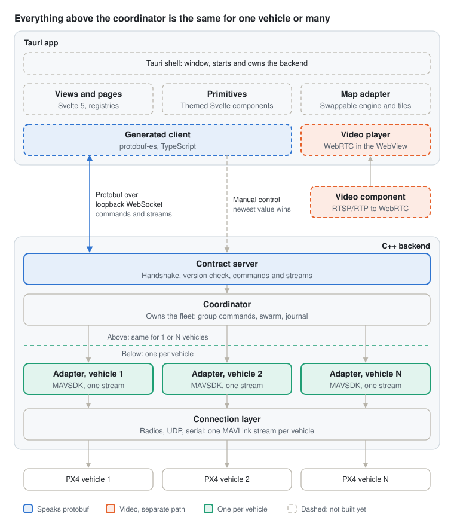

# PX4 Falconer

Falconer is a mission planning and execution app for [PX4](https://px4.io): a focused, lean command and control app for pilots, backed by the [Dronecode Foundation](https://dronecode.org).

> **Status:** early development, no usable release yet. The backend and a command-line client exist today; the app UI does not. See [Status](#status).

## Design goals

- **PX4 only**, from day one. Other autopilots are out of scope.
- **Pilot-first**: usable without developer knowledge, always the easiest option.
- **Mission planning and execution**, including survey, corridor and structure patterns, geofence, rally points, terrain-aware altitudes, validation and offline maps.
- **Manual flight** with telemetry, video and joystick or gamepad control.
- **Single vehicle, multi-vehicle and swarm coordination**, with Falconer itself acting as the coordinator.
- **No hardcoded vehicle limits**, with documented and tested performance tiers.
- **ULog download**: download, organize and hand off to analysis tools. No analysis in the app.
- **Crash recovery**: after a crash or restart, Falconer picks up exactly where the operator left off.
- **Vendor rebranding without code**: logo, colors and fonts through a theme. Layout changes require code.

## Non-goals

Falconer stays focused by leaving out everything that turns a ground station into a vehicle configuration tool.

- No vehicle setup, calibration, tuning, parameter editing or firmware flashing. Read-only preflight checks are allowed.
- No log analysis. Logs are downloaded and handed off.
- No support for other autopilots.
- No raw MAVLink in the UI. MAVLink stops at the backend.
- No custom MAVLink dialects. Vendors fork, or get support added upstream in MAVSDK.
- No plugin system in v1.
- No public API. The backend contract serves Falconer's own UI only.
- No remote UI or remote backend. UI and backend always run on the same machine.
- No support for older devices or OS versions.

## Architecture

Falconer is two halves on the same machine: a Svelte 5 UI in a Tauri 2 shell, and a C++ backend built around [MAVSDK](https://github.com/mavlink/MAVSDK), joined by an internal protobuf contract.



The coordinator is where single and multi-vehicle split. Above it nothing knows how many vehicles exist; below it everything is per vehicle, and a single vehicle is simply a fleet of one.

- **Contract**: protobuf over a single loopback WebSocket, versioned in lockstep with the app. The backend binds `127.0.0.1` on a random port, the shell hands it fresh secrets per launch, and both sides prove them before anything else is exchanged. Anything else on the machine is refused. See [`proto/falconer/v1/contract.proto`](proto/falconer/v1/contract.proto).
- **Coordinator**: owns the fleet. Every vehicle command takes a list of vehicles and returns one result per vehicle, so partial failures are explicit.
- **Vehicle adapters**: one MAVSDK instance per vehicle, each fed exactly one MAVLink stream.
- **Connection layer**: owns the links and splits incoming MAVLink into one stream per vehicle. Two vehicles with the same system ID are kept apart and flagged, never merged.
- **Video** runs on its own path, never through the contract, and reaches the WebView over WebRTC.
- **Platforms**: Windows, macOS, Linux, iOS and Android, including Android handheld controllers. Current hardware and the latest two major OS versions only.

## Status

| Part | State |
| --- | --- |
| Contract, handshake, local security | Working |
| Connection layer (UDP), per-vehicle adapters | Working; radios and serial not yet |
| Coordinator: group arm, takeoff, land, RTL | Working; missions, swarm and journal not yet |
| `fctl` CLI and terminal dashboard | Working |
| Tauri app, UI, maps, video, manual control | Not started |

## Repository layout

| Path | What |
| --- | --- |
| `proto/` | The UI/backend contract |
| `backend/` | C++ backend (`falconer-backend`) |
| `cli/` | `fctl`, the command-line client used for backend development |
| `sitl/` | Pinned PX4 SITL container image |
| `docs/` | Diagrams |

## Development

The backend is developed and tested without the UI. `fctl` stands in for it: it starts the backend the way the Tauri shell will, authenticates over the contract, and drives vehicles from a live dashboard, a shell or a script.

Requirements (macOS, Homebrew): `cmake ninja mavsdk protobuf boost openssl@3`, plus Docker for PX4 SITL. FTXUI is fetched by CMake.

```sh
cmake -S . -B build -G Ninja
cmake --build build

./build/cli/fctl sitl up 2       # two PX4 SITL (SIH) vehicles in Docker
./build/cli/fctl top             # live dashboard: fleet table, vehicle detail, events, command line
./build/cli/fctl                 # plain interactive shell; type "help"
./build/cli/fctl run -c "wait 2; wait-until all armable; arm all; takeoff all 10; wait-alt all 9.5; land all"
./build/cli/fctl sitl down
```

`fctl run` stops at the first failed command and exits non-zero. Backend logs and SITL ULogs go to `.falconer/`. The SITL image is pinned in `sitl/image`.

For a sanitizer build, add `-DFALCONER_SANITIZER=address` (or `thread`) in a separate build directory.

## License

[MIT](LICENSE)
