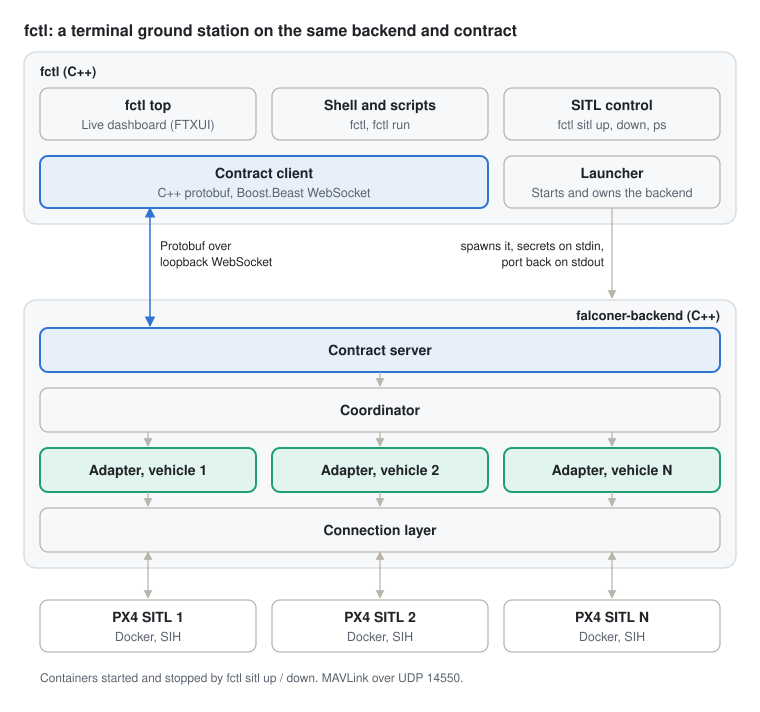

# PX4 Falconer

Falconer is a mission planning and execution app for [PX4](https://px4.io): a focused, lean command and control app for pilots, backed by the [Dronecode Foundation](https://dronecode.org).

**Two apps, one backend.** Falconer is built as one C++ backend that does all vehicle work, with two ground stations on top of it:

- **Falconer app**: the graphical ground station for desktop and mobile, web-based in TypeScript (Svelte 5 in a Tauri 2 shell).
- **[fctl](#fctl-terminal-ground-control-station)**: the terminal ground station, written in C++.

Both speak the same contract to the same backend, so a vehicle behaves the same whichever one is flying it.

> **Status:** early development. The backend and fctl fly vehicles today; the Falconer app has a first map view running in the browser. See [Status](#status).

## Design goals

- **PX4 only**, from day one. Other autopilots are out of scope.
- **Pilot-first**: usable without developer knowledge, always the easiest option.
- **Mission planning and execution**, including survey, corridor and structure patterns, geofence, rally points, terrain-aware altitudes, validation and offline maps.
- **Manual flight** with telemetry, video and joystick or gamepad control.
- **Single vehicle, multi-vehicle and swarm coordination**, with Falconer itself acting as the coordinator.
- **No hardcoded vehicle limits**, with documented and tested performance tiers.
- **ULog download**: download, organize and hand off to analysis tools. No analysis in the app.
- **Crash recovery**: after a crash or restart, Falconer picks up exactly where the operator left off.
- **Vendor rebranding without code**: logo, colors and fonts through a theme. Layout changes require code.

## Architecture

The backend is C++ built around [MAVSDK](https://github.com/mavlink/MAVSDK). Each app starts its own backend on the same machine and talks to it over an internal protobuf contract. The diagram shows the Falconer app; fctl replaces the top half with C++ (see [fctl](#fctl-terminal-ground-control-station)).


The coordinator is where single and multi-vehicle split. Above it nothing knows how many vehicles exist; below it everything is per vehicle, and a single vehicle is simply a fleet of one.

- **Contract**: protobuf over a single loopback WebSocket, versioned in lockstep with the app. The backend binds `127.0.0.1` on a random port, the shell hands it fresh secrets per launch, and both sides prove them before anything else is exchanged. Anything else on the machine is refused. See [`proto/falconer/v1/contract.proto`](proto/falconer/v1/contract.proto).
- **Coordinator**: owns the fleet. Every vehicle command takes a list of vehicles and returns one result per vehicle, so partial failures are explicit.
- **Vehicle adapters**: one MAVSDK instance per vehicle, each fed exactly one MAVLink stream.
- **Connection layer**: owns the links and splits incoming MAVLink into one stream per vehicle. Two vehicles with the same system ID are kept apart and flagged, never merged.
- **Video** runs on its own path, never through the contract, and reaches the WebView over WebRTC.
- **Platforms**: Windows, macOS, Linux, iOS and Android, including Android handheld controllers. Current hardware and the latest two major OS versions only.

## fctl: terminal ground control station

fctl is a complete ground control station that runs in a terminal. It uses the same backend and the same contract as the Falconer app, so every command goes through the same coordinator, per-vehicle adapters and safety checks. It runs anywhere a terminal does, including over SSH and on headless Linux machines, and every operation can be scripted.



- **Live fleet dashboard** (`fctl top`): every vehicle's link, arming state, mode, altitude, speed, battery and GPS, refreshed live, with a detail panel for the selected vehicle and an event log.
- **Group commands**: arm, take off, land and return to launch any set of vehicles at once, with a result per vehicle, so a partial failure is never hidden.
- **Arming checks**: PX4's own reasons a vehicle cannot arm, shown as they change.
- **Scripting**: `fctl run` executes a command sequence, stops at the first failure and exits non-zero, for repeatable operations and automation.
- **Secure by default**: fctl starts its own backend on `127.0.0.1` with fresh secrets per launch, and the two authenticate each other before any command is accepted.
- **Simulation built in**: `fctl sitl up N` starts N PX4 SITL vehicles in Docker, from a pinned image.

```sh
fctl top                 # live dashboard with a command line
fctl                     # interactive shell; type "help"
fctl run -c "wait 2; wait-until all armable; arm all; takeoff all 10; wait-alt all 9.5; land all"
fctl run mission.fctl    # commands from a file, one per line

fctl sitl up 2           # two simulated PX4 vehicles
fctl sitl ps
fctl sitl down
```

Vehicles connect over MAVLink on UDP port 14550 (`--mavlink-port` to change). Backend logs and simulator ULogs are written to `.falconer/` (`--data-dir` to change).

## Status

| Part | State |
| --- | --- |
| Contract, handshake, local security | Working |
| Connection layer (UDP), per-vehicle adapters | Working; radios and serial not yet |
| Coordinator: group arm, takeoff, land, RTL, mission upload and start | Working; swarm and journal not yet |
| fctl: dashboard, shell, scripting, missions, SITL | Working; manual control not yet |
| Falconer app: map view, live vehicles, mission route, mission controls | Working in the browser; Tauri shell, planning, video and manual control not yet |

## Repository layout

| Path | What |
| --- | --- |
| `proto/` | The contract between the ground stations and the backend |
| `backend/` | C++ backend (`falconer-backend`) |
| `cli/` | fctl, the terminal ground control station |
| `app/` | Falconer app (Svelte 5, TypeScript) and its integration tests |
| `missions/` | Example missions (QGroundControl `.plan`) |
| `sitl/` | Pinned PX4 SITL container image |
| `docs/` | Diagrams |

## Building from source

Requirements (macOS, Homebrew): `cmake ninja mavsdk protobuf boost openssl@3`. Docker is needed for `fctl sitl`. FTXUI is fetched by CMake.

```sh
cmake -S . -B build -G Ninja
cmake --build build
```

This builds `build/backend/falconer-backend` and `build/cli/fctl`; fctl finds the backend it was built with. For a sanitizer build, add `-DFALCONER_SANITIZER=address` (or `thread`) in a separate build directory.

### Falconer app

The app runs in the browser during development; the Tauri shell comes later. Requires Node 24 and the backend built above.

```sh
cd app
npm install              # also generates the contract client
npm run dev              # http://127.0.0.1:5173, starts its own backend
```

The dev server plays the Tauri shell's role: it starts `falconer-backend` with fresh secrets and hands them to the page. It listens on `127.0.0.1` only and is for development, not deployment. Map tiles come from OpenStreetMap.

### Integration test

`npm run test:integration` (in `app/`) starts a fresh PX4 SITL vehicle and the app, then flies the example mission entirely through the UI: load, upload, arm, start. It checks that the route is drawn, the vehicle climbs, its marker moves along the planned route and the mission advances, and that the marker matches the telemetry panel. A run takes about 1.5 minutes and records a video and screenshot in `.falconer/test-results/`.

It refuses to run if fctl SITL containers are already up, since they may be someone else's; set `FALCONER_TEST_RESTART_SITL=1` to replace them, or `FALCONER_TEST_KEEP_SITL=1` to leave the vehicle running afterwards.

## License

[MIT](LICENSE)
